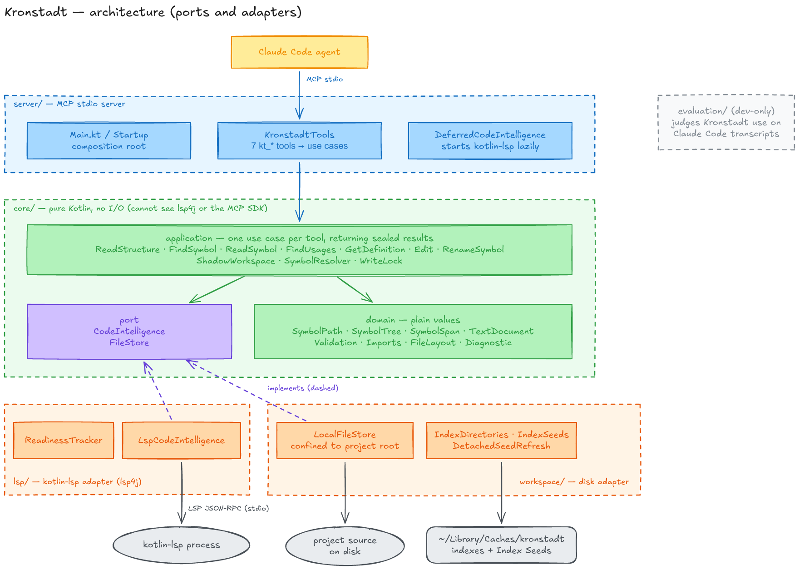

# Kronstadt

A Kotlin-only MCP server that gives coding agents (Claude Code, etc.) symbol-level access to a Kotlin codebase,
backed by JetBrains' [kotlin-lsp](https://github.com/Kotlin/kotlin-lsp) (see ADR 0001). Inspired by [Serena](https://github.com/oraios/serena), specialised for Kotlin/JVM.

## Tools

| Tool | Status | What it does |
|---|---|---|
| `kt_read_structure` | ✅ | Skeleton of a file: declarations with their canonical Symbol Path, signature and line span, no bodies |
| `kt_find_symbol` | ✅ | Declaration search by (partial) name in project source, optional kind filter; results grouped by file with their canonical Symbol Path and line span |
| `kt_read_symbol` | ✅ | One declaration's exact source (KDoc, annotations, body), addressed by Symbol Path, e.g. `Calculator/parse(String)`; the file is optional (`com.example.a/Config` narrows by package) |
| `kt_find_usages` | ✅ | Every Usage of a Symbol in main and test source, grouped by file and by the canonical Symbol Path containing it; imports only counted, at most 100 Usages in whole files, `file` shows one file, `declaredIn` resolves the Symbol in the file that declares it |
| `kt_get_definition` | ✅ | Where a name used inside a Symbol is declared (`at` picks one occurrence): a project declaration's KDoc and declaration without the body, a local's enclosing Symbol, or a library's fully qualified name, jar and KDoc and declaration, read-only |
| `kt_edit` | ✅ | An ordered batch of Operations (`replace`, `insert_before`, `insert_after`, `delete`, `edit_in` on a Symbol or a whole file, `create` for a new file), possibly across files, each optionally listing `imports` to add, and removing the imports the Edit made unused; validated once and written all-or-nothing, only if it adds no compiler errors |
| `kt_rename_symbol` | ✅ | Renames a Symbol and every reference across files and modules through kotlin-lsp, and the file of a class named like it (never onto an existing file); validated and written all-or-nothing like `kt_edit`; removes only the imports it made unused, like `kt_edit`; reports each changed file's references and imports, the imports removed and the new canonical path |

## Architecture

Ports and adapters. Gradle modules make the build enforce the boundary: `core` cannot see lsp4j or the MCP SDK.



```
core/        pure Kotlin, no I/O
  domain/      Position, TextRange, TextDocument (offset math), PackageHeader (a file's package), CodeSymbol,
               SymbolPath, SymbolTree (resolution, canonical paths), SymbolSpan, FileLayout (re-indent),
               Diagnostic, Validation (new-error diff)
  port/        CodeIntelligence, FileStore
  application/ ReadStructure, FindSymbol, ReadSymbol, Edit — one use case per MCP tool, returning sealed results;
               ShadowWorkspace (documents one Edit opens), WriteCalls (one write call at a time; owns the Rejected Edit)
lsp/         CodeIntelligence over kotlin-lsp (lsp4j), incl. readiness tracking
workspace/   FileStore over the local disk, confined to the project root;
             IndexDirectories (kotlin-lsp index per worktree and Index Seed slots, under ~/Library/Caches/kronstadt);
             IndexSeeds (seed a new worktree's index, refresh the seed once kotlin-lsp exits; clonefile via FFM);
             DetachedSeedRefresh (that refresh, in a process that outlives Kronstadt: ADR 0005)
server/      MCP stdio server: tool schemas -> use cases; Replies (and StructureRenderer) word their results;
             composition root (Main.kt)
evaluation/  dev-only, never shipped: judges v1 on Claude Code transcripts (see Evaluation below)
```

Rules of thumb:
- Testable with plain values → `domain`. Coordinates ports → `application`. Protocol details → adapters.
- Use cases return sealed results (e.g. `NotKotlin`, `OutsideProject`) that the MCP layer turns into actionable
  messages. Infrastructure failures (language server down, timeouts) become tool errors.
- stdout is reserved for MCP. `Main.kt` redirects `System.out` to stderr so no library can corrupt the stream.

## Build

Requires JDK 25.

```sh
./gradlew build                # compile + fast tests, incl. :server:launcherTest (the installed launcher's JDK choice)
./gradlew :lsp:contractTest    # slow contract tests against a real kotlin-lsp (Seam 2)
./gradlew :server:contractTest # the server against a real kotlin-lsp, e.g. ended the way Claude Code ends it
./gradlew installDist          # -> server/build/install/kronstadt/bin/kronstadt
```

The contract tests import and index the fixture project in `lsp/src/test/fixture` with the kotlin-lsp on your PATH
(or `$KRONSTADT_LANGUAGE_SERVER`).

## Use with Claude Code

You need [kotlin-lsp](https://github.com/Kotlin/kotlin-lsp) installed; Kronstadt never bundles it. Kronstadt is
tested against kotlin-lsp 271.2085.0 and warns on stderr when the server reports another version.

```sh
claude mcp add kronstadt -- /path/to/kronstadt/server/build/install/kronstadt/bin/kronstadt
```

Allow Kronstadt's tools so agents don't stop at a permission prompt and fall back to the built-in tools. In
`.claude/settings.json`:

```json
{ "permissions": { "allow": ["mcp__kronstadt__*"] } }
```

If Kronstadt comes bundled in a Claude Code plugin, the rule is `mcp__plugin_<plugin>_<server>__*` instead.

The server's instructions tell agents which tool to use instead of `Read`, `grep` and `Edit` for Kotlin, and to retry
rather than fall back while kotlin-lsp is still indexing.

### Use it in all your repos

Register Kronstadt at user scope, and put the allow rule in `~/.claude/settings.json`:

```sh
claude mcp add --scope user kronstadt -- /path/to/kronstadt/server/build/install/kronstadt/bin/kronstadt
```

Rebuilding with `./gradlew installDist` updates that binary in place. Restart Claude Code sessions to pick it up.

### Which Java it runs on

Claude Code starts Kronstadt in each project's directory, and a project may pin an older JDK (jenv, asdf, sdkman)
through `JAVA_HOME` or `PATH`. So the launcher doesn't follow them: it runs on the JDK it was built with, whose path
`installDist` records in it. To run it on another JDK 25+, set `KRONSTADT_JAVA_HOME` to that JDK's home, e.g. with
`claude mcp add ... -e KRONSTADT_JAVA_HOME=/path/to/jdk-25 ...`. If the recorded JDK is gone (say a package manager
upgraded it), the launcher falls back to `JAVA_HOME`, then `java` on the `PATH`; rerun `./gradlew installDist` to
record the current one.

If Claude Code shows `CONNECTION_CLOSED` as soon as Kronstadt starts, check its stderr (`claude --debug`, or run the
launcher yourself from that project's directory) for `UnsupportedClassVersionError`: it ran on a JDK older than 25.

To make agents use Kronstadt for every Kotlin change and report what goes wrong, add this to `~/.claude/CLAUDE.md`:

```markdown
## Kotlin code (Kronstadt)

This section applies only when the Kronstadt MCP server is enabled in the session, i.e. `mcp__kronstadt__*` tools are
available. If they aren't, ignore it and use the built-in tools.

For every change to a `.kt` file, production and test code alike, use the Kronstadt MCP tools (`mcp__kronstadt__*`)
instead of the built-in tools:
- Read: `kt_read_structure` for a file's skeleton, then `kt_read_symbol` for one declaration, instead of Read.
- Search: `kt_find_symbol` and `kt_find_usages` instead of grep. Navigate with `kt_get_definition`.
- Change: `kt_edit` (create new files with its `create` Operation) and `kt_rename_symbol` instead of Edit/Write.
- If a tool fails because kotlin-lsp is still indexing, retry it; don't fall back.

Use another tool only when a Kronstadt tool failed or gave a wrong result. Say so, and use the other tool for that
one change only.

### Reporting Kronstadt bugs and feature requests

When you hit a Kronstadt bug, or a missing capability that would have helped, open an issue directly in
`abellagonzalo/kronstadt` (`gh issue create -R abellagonzalo/kronstadt`) without asking. Check
`gh issue list -R abellagonzalo/kronstadt --search "<keywords>"` first to avoid duplicates.

That repo is **public**. Anonymise everything in the issue, including code:
- No company, repo, service, team, people or customer names, and no internal URLs, hostnames, paths, tickets, data,
  or secrets.
- Rewrite code as a minimal generic repro (`com.example`, `Foo`, `Bar`, `doSomething`) that keeps only the Kotlin
  constructs that trigger the bug. Never paste the original code.
- Give the tool name, the arguments (anonymised), the expected result, the actual result and error text
  (anonymised), and the Kronstadt and kotlin-lsp versions if known.
```

Options:
- `--project-root <dir>`: project or worktree to serve (default: current directory, i.e. where Claude Code runs).
- `--language-server "<command>"`: which kotlin-lsp to run. Defaults to `$KRONSTADT_LANGUAGE_SERVER`, else
  `kotlin-lsp --stdio`.
- `--readiness-timeout <seconds>`: how long tools that need the index wait for kotlin-lsp to finish importing and
  indexing. Defaults to `$KRONSTADT_READINESS_TIMEOUT`, else 90.

kotlin-lsp starts as soon as Kronstadt does and imports the project in the background. `kt_find_symbol`, `kt_find_usages`, `kt_get_definition`, `kt_edit` and `kt_rename_symbol` wait until
the import has finished and no indexing is in progress, also after a later re-import. If that takes longer than the
readiness timeout, it fails with a retry error rather than returning partial results.

Each instance spawns its own language server bound to one project root, so parallel agents in separate Git
worktrees don't share state. Mind the memory: one JVM language server per agent.

Kronstadt keeps each worktree's kotlin-lsp index in `~/Library/Caches/kronstadt/index/<hash of worktree path>/`
(about 1 GB each), never in JetBrains' default cache. At every start it deletes the indexes of worktrees that no
longer exist.

Worktrees of one clone share an Index Seed in `~/Library/Caches/kronstadt/seed/<hash of git common dir>/`. Each time
an instance ends with a complete index, Kronstadt asks kotlin-lsp to shut down and hands the refresh to a detached
process (ADR 0005): it waits for kotlin-lsp to exit and release its index, clones the index copy-on-write (`clonefile`)
and atomically swaps it in as the new seed. That process logs what it did to `last-refresh.log` in the seed's directory.
A worktree without an index starts from a clone of the seed, ready in seconds at about 1 GB instead of indexing cold at
about 5 GB. With no seed yet, outside a git repository, or on a volume without copy-on-write (anything but APFS), it
indexes cold; Kronstadt never falls back to a full copy, and never clones the index of a running instance.

## Evaluation (dev-only)

`evaluation/` reads Claude Code transcripts (`~/.claude/projects/**/*.jsonl`, subagents included) and judges v1 against
its bar: 0 corrupted files, 0 circumventions, and at least 80% of Kotlin reads and searches through Kronstadt. It
prints each sample session, then the totals, and exits 0 only if the sample is complete (at least 30 sessions spanning
14 days) and meets the bar. It is not part of the server.

```sh
./gradlew -q :evaluation:run --args="--include $HOME/github/traderepublic --exclude $HOME/github/abellagonzalo/kronstadt --since 2026-12-01"
```

- Sample: sessions started on or after `--since`, working inside an `--include` directory and no `--exclude` one,
  that touch a `.kt` file (`.kts` doesn't count).
- Read/search share: Kronstadt read/search calls ÷ (those + `Read` of a `.kt`, and `Grep`/`Glob` on a `.kt` path, a
  `*.kt` glob or `type: kotlin`), over the whole sample.
- Circumventions, inside the session's project: Bash writes to an existing `.kt` (`sed -i`, `perl -i`, `>`/`>>`,
  `tee`, `cp`/`mv` onto it), and `Write` recreating a `.kt` the session deleted (`rm`, `git rm`). Existence is judged
  from the session: in-place editors need an existing file; other writes count if an earlier call or result named
  the path, so a heredoc creating a new file doesn't. A `cd` earlier in the same command is followed.
- Corrupted files: every commit a session's `git` command printed (`[branch hash] subject`) is checked out with its
  parent into throwaway worktrees, and `./gradlew compileKotlin compileTestKotlin` runs on the modules owning its
  `.kt` files. A file counts when the commit's compiler errors are in it, the parent compiled, and a Kronstadt
  Write-back (`Edited <file>`, relative to the project root) touched it in that session. Commits that can't be
  checked (repo gone, build failing without compiler errors) are listed as unchecked and leave this bar unmet.
  `--no-compile` skips compiling; each compile is logged on stderr.
- Informational: Bash `grep`/`rg`, `cat` and `sed -n` on Kotlin; hook denials (a failed `Edit`/`MultiEdit`/`Write`
  whose message names `kt_edit`) by what the same agent did next; Validation rejections per `kt_edit` that reached
  Validation; readiness timeouts.

## Known limitations

- Declaration headers are the single source line holding the symbol's name; multi-line signatures are truncated.
- Dependency symbols (`searchDependencies` in the original design) are filtered out.
